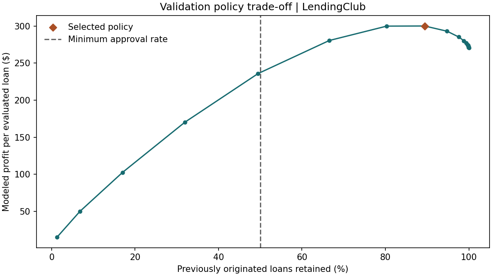

# Loan Default Risk & Lending Strategy Analysis

**Recommendation.** Advance the 20% predicted-default cutoff to a newer-cohort backtest. It retained 88.5% of the 2015 LendingClub holdout and lowered the charge-off rate among retained loans from 14.9% to 13.5%. At the stated funding and operating costs, the cutoff improved historical cash-flow margin by **$13.1 million across the holdout** ($46.25 per evaluated loan).

[Download the one-page Excel dashboard](Lending_Strategy_Dashboard.xlsx).

## 2015 LendingClub holdout

| Policy | Loans retained | Observed charge-offs among retained loans | Modeled profit per evaluated loan | Historical cash-flow margin per evaluated loan |
| --- | ---: | ---: | ---: | ---: |
| Approve all | 283,026 (100.0%) | 14.89% | $61.20 | −$106.27 |
| Retain loans at or below 20% predicted risk | 250,339 (88.5%) | 13.46% | $112.89 | −$60.01 |

Both policies use all 283,026 holdout originations as the per-loan denominator. Differences use unrounded values. See the [decision memo](DECISION_MEMO.md), [policy results](empirical/test_policies.csv), [model metrics](empirical/model_metrics.json), and [segment breakdown](empirical/test_segments.csv).



## Cost sensitivity and break-even

Before funding and operating costs, the holdout generated $229.8M in historical cash margin under approve-all and $217.3M under the cutoff. The cutoff gives up some gross margin and funds fewer loans. At the assumed 4% annual funding rate and $150 operating cost, those expense savings more than offset the foregone gross margin.

| Break-even condition | Approve all | 20% cutoff |
| --- | ---: | ---: |
| Maximum average combined cost per funded loan | $812.07 | $867.84 |
| Maximum annual funding rate at $150 operating cost per funded loan | 3.45% | 3.65% |
| Maximum operating cost per funded loan at 4% annual funding | $43.73 | $82.15 |

At $150 operating cost per funded loan, the cutoff leads when annual funding exceeds about 1.48%. Below that crossover, approve-all leads in total margin. See the [break-even calculations](empirical/cost_break_even.csv).

## Who the policy excludes

| Holdout segment | Loans | Share excluded |
| --- | ---: | ---: |
| Renters | 121,463 | 19.9% |
| Mortgage holders | 129,762 | 3.7% |
| Debt consolidation | 160,983 | 11.1% |
| Credit card | 70,650 | 3.5% |

Excluded loans charged off at 25.8%. Higher FICO and income had the strongest negative coefficients among standardized numeric features. Higher debt-to-income had the strongest positive numeric coefficient. The coefficients describe associations within the fitted model. Segment exclusion rates reflect the joint distribution of features and do not isolate any single factor's effect. See the [model coefficients](empirical/risk_drivers.csv).

## Expanded-feature challenger

The challenger adds revolving utilization, recent inquiries, two-year delinquencies, employment length, and credit history length at origination. It excludes LendingClub's internal grade. With the same vintage split and validation rule, it also selected a 20% cutoff.

| Metric | Original model | Expanded challenger |
| --- | ---: | ---: |
| 2014 validation ROC AUC | 0.639 | 0.646 |
| 2015 holdout ROC AUC | 0.641 | 0.651 |
| 2015 holdout average precision | 0.222 | 0.232 |
| 2015 historical cash-flow margin improvement vs. approve-all | $13.1M | $15.7M |

The challenger retained 89.3% of the holdout, with a 13.35% charge-off rate among retained loans and a historical cash-flow margin of −$50.73 per evaluated loan. This follow-up reuses the original holdout, so the challenger needs confirmation on a fresh vintage. See the [challenger policy results](empirical/challenger_test_policies.csv).

## Reproduce

Requires Python 3.10 or newer. Download `accepted_2007_to_2018Q4.csv.gz` from the [Kaggle LendingClub archive](https://www.kaggle.com/datasets/wordsforthewise/lending-club) and place it in `data/`. The file used for the published run has MD5 `e2d05a00a4b854a58e67fdaacebb2b63`.

```bash
python -m pip install -r requirements.txt
python analyze.py --csv data/accepted_2007_to_2018Q4.csv.gz --output outputs
```

For a quick synthetic smoke test, run `python analyze.py --demo`. The analysis writes aggregate CSVs, a JSON metrics summary, and a chart. The raw archive stays local.

## Method

- **Cohorts.** Use 36-month loans with a Fully Paid or Charged Off status. Fit logistic regression and preprocessing on 100,422 loans from 2013. Select the cutoff on 162,570 loans from 2014 by maximizing modeled profit subject to at least 50% retention. Evaluate the chosen policy on 283,026 loans from 2015.
- **Features and model performance.** Use loan amount, income, debt-to-income ratio, lower FICO bound, open accounts, home ownership, and loan purpose. Holdout ROC AUC was 0.641. Average precision was 0.222 versus a 0.149 base rate. Observed charge-offs exceeded average predicted probability in every reported risk band. Cohort charge-offs rose from 12.33% in the 2013 training vintage to 13.73% in 2014 and 14.89% in the 2015 holdout, consistent with the model underpredicting risk on the later cohort.
- **Profit in SQL.** [policy.sql](policy.sql) computes expected profit from survival-weighted contractual interest, 65% modeled loss given default, funding expense, and $150 operating cost per retained loan. The outcome-based measure substitutes actual principal and interest collected plus recoveries net of collection fees, minus the funded amount. Both measures subtract the same assumed operating and funding expenses. Funding expense approximates 4% annually over 1.5 exposure-years. The outcome measure is a historical cash-flow proxy.
- **Stress and pricing.** The stress scenario applies 80% loss given default and 50% higher funding expense. The pricing scenario raises contractual interest income by 10% while holding take-up and default risk fixed. Its output measures the arithmetic impact under those assumptions. Observed outcomes are reported for the two policies using original economics.
- **Segments in SQL.** [segments.sql](segments.sql) uses a CTE and UNION ALL to aggregate exclusions and observed charge-offs by loan purpose and home ownership.

The split is retrospective. The backtest uses eventual terminal outcomes, and some earlier-vintage labels would still have been unavailable when later loans were issued. The archive contains historical originations, so the policy compares which previously funded loans it would retain. The study has no repayment outcomes for rejected applicants or people who declined an offer. The figures use undiscounted cash flows and simplified costs, and pricing results do not estimate a causal APR effect.
